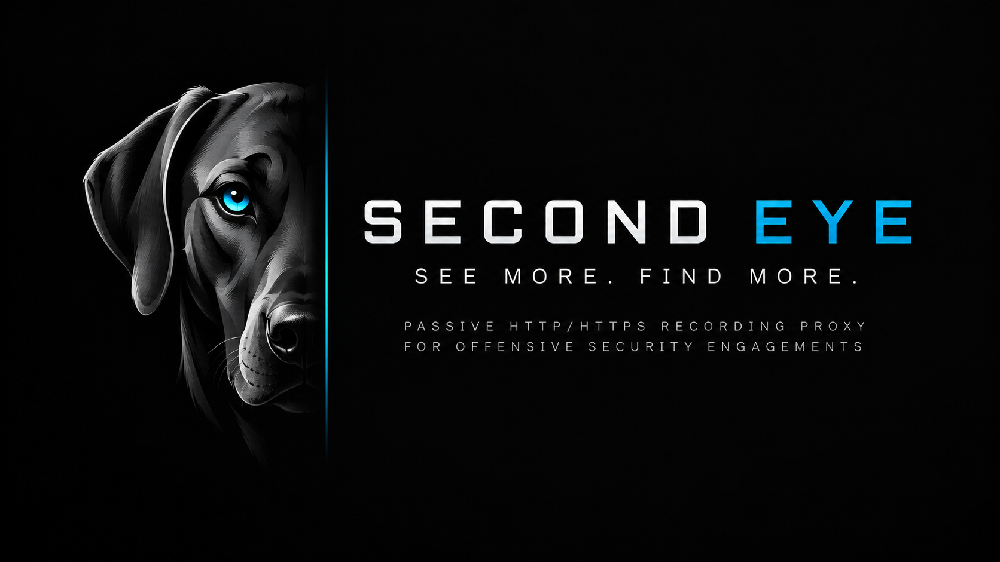
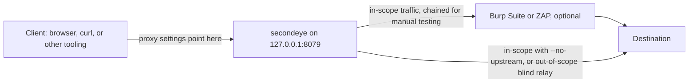
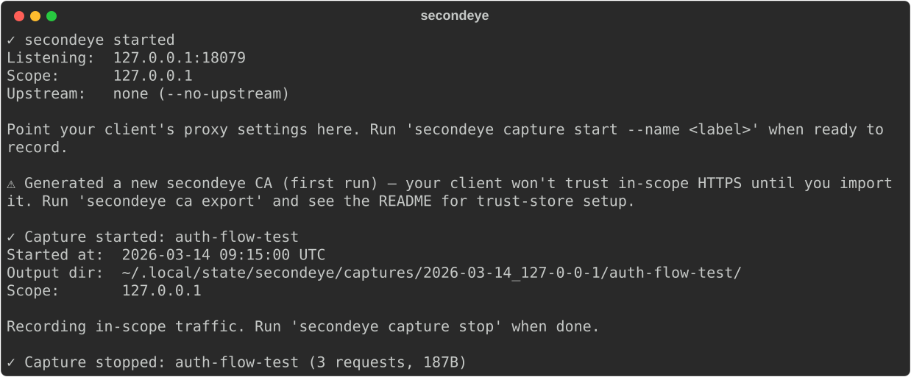

# second-eye

> The name borrows from marksmanship: a sniper or hunter keeps their non-dominant
> eye — the "off eye," or second eye — open alongside the aiming eye, not to aim,
> but to hold situational awareness of the wider field while the dominant eye
> stays locked on the target. `secondeye` plays that role in an engagement: it
> runs alongside your primary tooling — your browser, Burp, ZAP — quietly
> building situational awareness of the traffic your target generates, so
> nothing outside your immediate focus goes unnoticed.

A scope-gated, passive HTTP/HTTPS recording proxy for offensive security operators.

`secondeye` sits between your client (browser, curl, another tool) and either the
destination directly or an upstream intercepting proxy (Burp Suite, OWASP ZAP).
Traffic to explicitly scoped target domains is recorded to disk and rendered into
an AI-consumable analysis document; everything else passes through untouched, with
zero TLS termination or inspection.



**Core value proposition:** low-effort, structured capture of a specific target's
traffic — packaged for handoff to an AI chat (corporate-agreement AI or in-house
LLM) for flow analysis — without giving up the ability to chain through a
traditional interception proxy for manual testing.

<!-- BEGIN GENERATED: hero -->

<!-- END GENERATED: hero -->

*A full session: start the daemon, record a labeled window of in-scope traffic,
stop. Recorded from a real run — see [Checking on a running
capture](#checking-on-a-running-capture) for the same output as text.*

Author context: Ridgeback InfoSec LLC — offensive security training/consulting
tooling. License: MIT. **Platform: Linux only** (v1); macOS may work incidentally
but is untested/unsupported, and there is no Windows support planned.

---

See [docs/ARCHITECTURE.md](docs/ARCHITECTURE.md) for diagrams of the operator
workflow and the per-connection scope decision.

## Install

`second-eye` isn't published to PyPI — install straight from GitHub:

```sh
pipx install git+https://github.com/ridgebackinfosec/second-eye.git
```

`pipx` is the primary supported install path — it keeps `secondeye` and its
dependencies isolated from your system/project Python environments.

**Manual venv fallback:**

```sh
git clone https://github.com/ridgebackinfosec/second-eye.git
cd second-eye
python -m venv .venv
source .venv/bin/activate
pip install -e .
```

### Shell completion

`secondeye` ships with tab-completion for bash and zsh via `argcomplete`,
derived directly from the CLI's own flag definitions so it can't drift out of
sync. One-time global setup (covers every `argcomplete`-enabled tool, not
just `secondeye`):

```sh
activate-global-python-argcomplete --user
```

Or, to enable it for `secondeye` only, add this to your `.bashrc`/`.zshrc`:

```sh
eval "$(register-python-argcomplete secondeye)"
```

---

## One-time setup: trust secondeye's CA

`secondeye` terminates TLS for in-scope traffic using its own locally-generated
root CA (never shared, never uploaded anywhere). Your client needs to trust it
before in-scope HTTPS traffic will work.

```sh
secondeye ca export --format der > secondeye-ca.der
```

Import `secondeye-ca.der` into your browser's or device's trust store as a
trusted root certificate authority. `--format pem` is also available if your
target trust store prefers PEM.

The CA is generated once on first run and persisted to
`~/.local/state/secondeye/ca/`; every subsequent run reuses it, so you only need
to re-import it into a given trust store once.

### Chaining through Burp or ZAP

If you're chaining `secondeye` through an intercepting proxy for manual testing,
you also need `secondeye`'s connection *to that proxy* to trust its CA:

```sh
secondeye ca import-upstream --from-burp --upstream-proxy 127.0.0.1:8080 --output burp-ca.pem
```

This fetches Burp's CA from its well-known `/cert` export endpoint and converts it
to PEM. Use the resulting file with `--upstream-ca` when starting the daemon (see
below). If you'd rather export it yourself: Burp/ZAP → Proxy → Options → CA
Certificate → export DER, then `openssl x509 -inform der -in burp-ca.der -out
burp-ca.pem`.

Not chaining through anything? Use `--no-upstream` instead — see below.

---

## Basic usage

**Terminal 1 — start the daemon** (stays running in the foreground all day):

```sh
secondeye proxy start \
  --target example.com \
  --target-regex '^(dev|stg)-.*\.example\.com$' \
  --upstream-ca burp-ca.pem
```

Or, without chaining through Burp/ZAP:

```sh
secondeye proxy start --target example.com --no-upstream
```

### Multiple targets

`--target` is repeatable — pass it once per apex domain, plus a glob wildcard for
cases where the apex itself is unknown/variable:

```sh
secondeye proxy start \
  --target example.com \
  --target corp-example.net \
  --target '*.corp.internal' \
  --no-upstream
```

`--target-regex` is separately repeatable too, for patterns a glob can't express
(alternation, numeric ranges, wildcards on both sides — see `--help` for
examples). Everything you pass — every `--target` and every `--target-regex` — is
OR'd together: a domain is in scope if it matches *any* of them.

One quirk worth knowing if you mix multiple targets: only the *first* `--target`
value feeds the capture output directory's name
(`captures/<date>_<label>/<name>/`, e.g. `2026-09-15_example-com`). The other
targets/regexes are still fully enforced for scope matching and are all recorded
in `manifest.json`'s scope block and `ANALYSIS.md`'s header — they just don't
affect the directory name.

### Target files

For a long target list, `-tf`/`--target-file <path>` reads targets from a
line-delimited file instead of repeating `--target`:

```sh
secondeye proxy start --target-file targets.txt --no-upstream
```

```
# targets.txt — one target per line, same syntax --target accepts
example.com
corp-example.net
*.corp.internal
```

Blank lines and lines starting with `#` are ignored. `-tf`/`--target-file` is
repeatable too, and combines with any `--target`/`--target-regex` flags — all
of it is OR'd together the same way. `--target` is *not* required when a
target file supplies at least one entry; `-tf targets.txt` alone is a valid
scope. The directory-naming quirk above still applies: an explicit `--target`
value (if any) wins for the label, otherwise it falls back to the first
target file's first line.

Point your client at the proxy — `127.0.0.1:8079` by default (browser proxy
settings, or `curl -x 127.0.0.1:8079 ...`). Traffic flows normally from this point
on; nothing is recorded yet.

**Terminal 2 — record a labeled window of traffic:**

```sh
secondeye capture start --name auth-flow-test
```

Interact with the target through your client — browser clicks, curl calls,
whatever tooling you're using through the proxy. In-scope traffic is recorded
incrementally; nothing else is touched.

```sh
secondeye capture stop
```

This writes `raw.har`, `manifest.json`, and `ANALYSIS.md` to
`~/.local/state/secondeye/captures/<date>_<target>/<name>/`. Repeat
`capture start`/`capture stop` as many times as you like for different test
scenarios while the daemon keeps running.

**Analyze:** open `ANALYSIS.md` and paste it into your AI chat of choice
(corporate-agreement AI or in-house LLM — this tool assumes no redaction is
necessary because output only ever goes to a trusted destination you control). It's
purpose-built, clustered, and noise-reduced for exactly this. Reach for `raw.har`
only when you need exact ground truth (precise headers, byte-for-byte payloads)
beyond what the narrative captured — each flow in `ANALYSIS.md` carries a
`har_entry_index` cross-reference to jump straight to the right entry.
`manifest.json` is the structured/machine-readable form, meant for your own future
tooling rather than routine AI handoff.

### What `ANALYSIS.md` looks like

The excerpt below is the real output of a capture against a demo target — the
header block, the orientation `## Summary`, and the `## Capture Signals` audit.
Below these sections the document continues with a Mermaid sequence diagram, a
table of contents, and one narrative section per flow.

<!-- BEGIN GENERATED: analysis-excerpt -->
```markdown
# Second-Eye Capture Analysis

**Capture:** auth-flow-test
**Target(s):** app.example-corp.com
**Capture window:** 2026-03-14T09:15:00Z → 2026-03-14T09:16:30Z
**Total requests:** 13 (3 navigation, 8 xhr-api, 2 static-asset)
**Full fidelity data:** raw.har (this document is a derived summary)

---

## Summary

*Counts below exclude static-asset requests.*

**Endpoints touched:**
- **GET** /login
- **POST** *(state-changing)* /login
- **GET** /dashboard
- **GET** /api/v2/users/4815/profile
- **GET** /api/v2/reports
- **POST** *(state-changing)* /api/v2/reports
- **GET** /api/v2/admin/audit-log
- **GET** /api/v2/notifications
- **GET** /api/v2/reports/9001/export

**Auth mechanisms observed:**
- Bearer token: 8 request(s)
- session cookie: 9 request(s)

**Status codes:** 8x 200, 1x 201, 1x 302, 1x 403

**Parameter names observed:** `user_id` (query, 1x), `org_id` (query, 2x), `limit` (query, 1x), `since` (query, 3x), `format` (query, 1x), `title` (body, 1x), `owner_id` (body, 1x)

## Capture Signals

**Security headers observed:**
- Strict-Transport-Security: present on 0/11 responses
- Content-Security-Policy: present on 0/11 responses
- X-Frame-Options: present on 1/11 responses
- X-Content-Type-Options: present on 2/11 responses
- X-XSS-Protection: present on 0/11 responses
- Referrer-Policy: present on 0/11 responses
- Permissions-Policy: present on 0/11 responses

**Stack fingerprint hints:**
- `nginx` (Server header)

**Cookie flag issues:**
- `session`: missing Secure, SameSite (entry #3)
```
<!-- END GENERATED: analysis-excerpt -->

See [docs/examples/ANALYSIS.sample.md](docs/examples/ANALYSIS.sample.md) for the
complete document this excerpt came from, including the per-flow narrative,
redirect-chain detail, polling-group collapsing, and timing-outlier notes.

<details>
<summary><code>manifest.json</code> for the same capture (flows truncated to one)</summary>

<!-- BEGIN GENERATED: manifest-excerpt -->
```json
{
  "schema_version": "1.0",
  "capture": {
    "name": "auth-flow-test",
    "started_at": "2026-03-14T09:15:00Z",
    "ended_at": "2026-03-14T09:16:30Z",
    "duration_ms": 90000.0
  },
  "scope": {
    "targets": [
      "app.example-corp.com"
    ],
    "target_regex": [],
    "target_all": false,
    "upstream": null,
    "no_upstream": true
  },
  "stats": {
    "total_requests": 13,
    "by_category": {
      "navigation": 3,
      "xhr-api": 8,
      "static-asset": 2,
      "other": 0
    },
    "total_bytes_transferred": 1690,
    "domains_seen": [
      "app.example-corp.com"
    ]
  },
  "flows": [
    {
      "flow_id": 1,
      "started_at": "2026-03-14T09:15:00Z",
      "category": "navigation",
      "har_entry_indices": [
        0
      ],
      "redirect_chain": false,
      "summary": "GET /login \u2192 200"
    }
  ]
}
```
<!-- END GENERATED: manifest-excerpt -->

</details>

### Checking on a running capture

`secondeye proxy status` answers "is it up, what's in scope, and is it
recording?" from any terminal, including a live request count for the active
capture:

<!-- BEGIN GENERATED: proxy-status -->
```text
Daemon running: yes
Listener:       127.0.0.1:18079
Scope:          127.0.0.1
Upstream:       none (--no-upstream)
Active capture: auth-flow-test (started 09:15:00, 3 requests so far)
```
<!-- END GENERATED: proxy-status -->

And the start/stop pair reports where the capture landed and how much it caught:

<!-- BEGIN GENERATED: capture-stop-summary -->
```text
✓ Capture started: auth-flow-test
  Started at:  2026-03-14 09:15:00 UTC
  Output dir:  ~/.local/state/secondeye/captures/2026-03-14_127-0-0-1/auth-flow-test/
  Scope:       127.0.0.1

Recording in-scope traffic. Run 'secondeye capture stop' when done.

✓ Capture stopped: auth-flow-test (3 requests, 187B)
```
<!-- END GENERATED: capture-stop-summary -->

> These three blocks are recorded from a real daemon run against a local test
> server, which is why the scope reads `127.0.0.1` rather than a domain —
> recording live traffic against a realistic hostname would need DNS. The
> `ANALYSIS.md` example above comes from a committed capture fixture instead,
> so it shows a realistic target.

**Done for now?** `Ctrl+C` the daemon in Terminal 1 — it auto-flushes any active
capture before exiting, so you never lose a capture by forgetting to run
`capture stop` first.

---

## Other commands

```
secondeye proxy status                    # daemon running? scope? active capture + live count?
secondeye proxy stop                      # stop a daemon from another terminal
secondeye capture list                    # captures completed so far this run
secondeye ca status                       # CA fingerprint/expiry; never generates one
secondeye --version                       # print the installed version and exit
```

See **[docs/CLI.md](docs/CLI.md)** for the full flag reference on every
subcommand — generated from the real argument parser, so it can't drift from
what the program accepts. `secondeye <noun> <verb> --help` prints the same text
locally.

### A note on OAuth/OIDC and other third-party redirects

If the flow you're testing hops out to a third-party identity provider
(`accounts.google.com`, Okta, Auth0, Azure AD, ...), `--target`/`--target-regex`
were never meant to enumerate those. Use `--target-all` to bypass scope matching
entirely for the life of the daemon — every domain gets terminated and inspected,
but (per the no-active-capture invariant below) nothing is written to disk unless
a capture is actively running.

**Caveat:** some IdP mobile SDKs or hardened consent-flow implementations pin
certificates and will hard-fail against `secondeye`'s CA regardless of trust store
installation. This is an inherent limitation of any MITM-based interception proxy,
not a `secondeye` defect.

---

## Explicit non-goals (v1)

These are deliberate exclusions, not oversights:

- **No GUI/DOM rendering capture.** This is an HTTP proxy; it sees wire bytes, not
  rendered visual state or client-side SPA state changes.
- **No WebSocket recording.** HTTP request/response only. WebSocket frames on
  in-scope domains are passed through but not recorded or analyzed.
- **No redaction.** All captured data (headers, tokens, credentials, bodies) is
  recorded in full fidelity in both `raw.har` and `ANALYSIS.md`. This is
  deliberate — output is only ever handed to an AI chat under corporate agreement
  or an in-house LLM, so exposure to third parties isn't a concern in this threat
  model.
- **No config file support.** CLI flags only.
- **No Windows or macOS support.** Linux only.
- **No multi-session/nested capture support.** One active capture at a time,
  enforced as a hard error.
- **No remote/non-loopback operation.** The proxy listener and control socket are
  loopback-only, always. No flag exists to override this.

---

## Operational considerations

Two properties of the design above are worth knowing before pointing
`secondeye` at a target, or automating a high-volume workflow through it:

- **Response/request bodies are held fully in memory.** There is no
  `--max-body-size` flag and no cap on body accumulation — this follows
  directly from the no-truncation design above (a truncated in-memory
  buffer would mean a truncated capture). `--max-connections` bounds how
  many concurrent connections the proxy will accept, but not how large
  any single connection's body can be. A target that returns a very large
  or adversarially large response will consume proxy memory proportional
  to that response's size. Be mindful of this on memory-constrained hosts,
  or when scanning targets you don't fully trust.
- **`--upstream-proxy` misconfiguration relays everything, not just
  in-scope traffic.** If the host/port passed to `--upstream-proxy` is
  wrong (typo, stale value, or an unintended host reachable on the same
  network), every connection `secondeye` opens — in-scope traffic it
  decrypts, out-of-scope traffic it blind-relays, and plain-HTTP requests
  it forwards — gets routed through that host. This is inherent to how
  proxy chaining works (the same is true of Burp's or mitmproxy's own
  upstream-proxy features), not a `secondeye`-specific defect, but the
  blast radius is larger than the flag's name alone suggests.

---

## How it works, briefly

`secondeye` inspects the SNI from the TLS ClientHello *before* completing any
handshake, decides whether the domain is in scope, and only then branches:
out-of-scope traffic is blindly relayed byte-for-byte (zero cert operations, zero
inspection); in-scope traffic gets TLS-terminated with a per-SNI leaf cert signed
by `secondeye`'s own CA, parsed as HTTP/1.1, and — if a capture is currently
active — recorded. This is a deliberate contrast to blanket-MITM tools: your
client only needs to trust `secondeye`'s CA for the domains you actually scoped
in, cert-pinned out-of-scope apps aren't broken unnecessarily, and no crypto work
is spent decrypting traffic that's immediately discarded. See
[docs/ARCHITECTURE.md](docs/ARCHITECTURE.md) for a diagram of this decision.

Recording is capture-gated, not scope-gated: in-scope traffic flows normally
whether or not a capture is active, but nothing is buffered or written to disk
until you explicitly run `capture start`. This bounds memory usage on a
long-running daemon and means captures only ever contain what you explicitly
asked for.

---

## Development

See [CONTRIBUTING.md](CONTRIBUTING.md) for the full dev setup and
contribution workflow. Quick reference:

```sh
python -m venv .venv && source .venv/bin/activate
pip install -e ".[dev]"
pytest
ruff check .
ruff format --check .
mypy --strict src/secondeye
```
